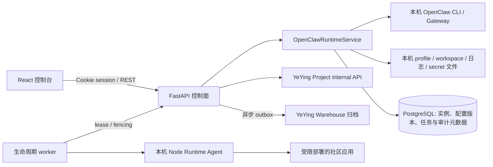

# Orchestrator 控制面技术设计

更新时间：2026-10-28
适用范围：当前仓库的控制台、API、运行时管理与节点应用部署能力。

本文刻意区分“已实现”与“目标架构”。产品边界、竞品类别和市场参考见[产品定位与领域架构](product-architecture.md)；本文件以代码现状为准，不把规划能力写成已交付能力。

## 1. 产品边界

Orchestrator 是管理 Agent Runtime 与其工作负载的控制面。它不负责 Agent 推理，不是 MCP Server，也不是通用工作流引擎。

```text
Organization / Project                 # 目标模型；组织/RBAC 尚未实现
  └── Runtime Node                      # 执行位置；已有服务端心跳接收，实际管理仍以本机为主
       └── Runtime Provider             # 管理协议/适配器；当前只有 OpenClaw 本机进程
            └── Runtime Instance        # 独立配置、profile、工作目录和端口
                 └── Workload           # Agent、消息工作台或社区应用
                      └── Tool / MCP Server
```

关键边界：

- Runtime Provider 描述“如何发现、创建和管理某类运行时”，不是某个具体进程或 MCP 服务。
- Runtime Node 是运行 Agent Runtime 的主机；心跳接收与在线判定 API 已实现，但节点 Agent 客户端和远程控制未交付。
- Runtime Instance 是某个 Runtime Node 上的运行时实例；当前实例只落在控制服务所在主机。
- Workload 是运行在 Runtime 或受管应用环境中的业务负载。消息和交易属于工作台，不是 Runtime 类型。
- MCP Server 是 Agent 可调用的工具服务；登记其连接信息不等于 Orchestrator 已管理其进程。
- Lifecycle Task 是已实现的社区应用安装、升级、卸载任务；OpenClaw 实例启停目前仍是本机同步操作，不应和异步部署任务混称。

## 2. 当前架构



### 2.1 前端

- `web/` 是 React + TypeScript + Vite SPA，控制台与消息、交易工作台共用登录会话和导航壳。
- 控制面页面是运行概览、Runtime Provider 状态和 Runtime Instance 列表；钱包登录页按需加载钱包 SDK。
- 页面查询与变更由 TanStack Query 封装；API 请求通过同源 `/api` 访问，开发环境由 Vite 代理至后端。
- 当前 UI 可操作本机 OpenClaw 实例。尚无节点注册/连接状态界面、跨节点调度和通用 Runtime 表单；心跳清单仅提供给持有运维 token 的 internal API 调用方。

### 2.2 后端

- `backend/src/orchestrator/api/` 提供 FastAPI public 与 internal 路由。
- `services/openclaw.py` 管理本机 OpenClaw profile、进程、配置、配对、日志和诊断。
- `services/nodes.py` 接收 Runtime Node 心跳并按服务端超时计算在线状态；这不代表已有可部署到远端主机的 Node Agent。
- `services/runtime_providers.py` 当前只检查本机 OpenClaw 可执行程序并返回能力清单；它是注册表入口，不代表已经有可插拔的异构适配器框架。
- `adapters/` 目前主要是 Messenger、Trader 等工作台适配器，不应误认为 OpenClaw/Nanobot/Hermes Runtime Provider 已经实现。
- `lifecycle_worker.py` 消费 Node 应用生命周期任务；与 Orchestrator Web/API 服务分进程运行。当前 worker、Node Runtime Agent 与受管应用都在同一主机，不使用 Docker 启动 Orchestrator 本身。

## 3. 领域状态与操作

实例至少有两类状态：

- `desired_state`：操作者要求的目标状态，例如 `running` 或 `stopped`。
- `observed_state`：本机进程管理器观察到的状态，例如 `starting`、`running`、`stopped`、`error` 或 `unknown`。

两者不能合并：用户发起启动并不意味着实例已健康运行。当前实例实现由 OpenClaw 本机服务执行启停并更新记录；Runtime Node 心跳可上报主机/Provider 能力，但远程实例状态上报和持续 reconcile 尚未完成。页面中的“运行中”表示本机当前观测，不代表端到端 Agent 业务健康。

当前控制台流程：

1. 钱包签名登录，后端建立 HttpOnly Cookie session。
2. 页面读取当前钱包拥有的实例，以及本机可执行的 Runtime Provider。
3. 用户通过消息工作台创建 OpenClaw 实例；服务分配实例 ID、端口、独立 profile 与工作目录，并把实例元数据存入配置的状态后端。
4. 用户启动/停止实例；操作由本机 OpenClaw Runtime Service 执行，失败时保留错误信息供日志和诊断查看。
5. 页面刷新观测状态、诊断结果与日志。连接渠道、模型调用和 Agent 回复仍由 OpenClaw 与相应上游负责。

生产应用部署流程是另一条异步链路：Project 提交幂等生命周期任务，PostgreSQL 保存任务和事件；专用 worker 以带租约和 fencing 的方式领取任务，校验发布制品和签名后交给本机 Node Runtime Agent 执行，并报告结果。当前不是远程 Runtime Node 部署。Worker 默认关闭，启用前置条件见[生产运维文档](operations.md)和[Agent Runtime Protocol](agent-runtime-design.md)。

## 4. 持久化边界

| 数据 | 权威存储 | 说明 |
|---|---|---|
| Runtime Instance、节点元数据、配置版本 | 配置 PostgreSQL 时使用 PostgreSQL；未配置时退回本机 JSON | JSON 模式只适合单进程开发或实验，不支持多副本一致性 |
| Project 安装状态、生命周期任务与事件、审计和 outbox 元数据 | PostgreSQL | 通过 Alembic 版本化迁移；任务有幂等、租约、attempt fencing 与退避重试 |
| OpenClaw profile、workspace、运行日志、配对文件 | 本机运行目录及仓库外的 profile 目录 | 与控制面数据库分开备份；日志正文和可重建进程状态不写入关系库 |
| 渠道密钥与应用环境凭证 | 当前为节点本地权限受限文件，数据库仅保存引用 | 尚未接入外部 Secret Manager/KMS；仍需密钥轮换设计 |
| 事件归档 | Warehouse 异步 outbox | Warehouse 是归档目标，不是运行状态权威来源 |
| Agent 长文本/检索向量 | 不在当前控制面 | 向量数据库不应替代实例、任务等事务状态库 |

本地和生产都从 `backend/.env` 读取参数。`HUB_*` 是现存环境变量契约，未随 Python 包名和目录改名一起修改；修改这些键需要单独的配置迁移，不要只改模板而不处理代码、脚本和部署环境。数据库、迁移、运行目录和备份要求见[运行时数据规划](runtime-data.md)。

## 5. API 边界

### Public 控制台 API

- `GET /api/v1/public/runtime/providers`：列出当前本机已实现的 Runtime Provider 与可检测能力；目前只返回 OpenClaw。
- `GET /api/v1/public/runtime/instances`：列出当前钱包拥有的实例与期望/观测状态。
- `POST /api/v1/public/runtime/instances`：创建 OpenClaw 实例；其他 `runtime_type` 明确拒绝。
- `POST /api/v1/public/runtime/instances/{id}/actions/{start|stop}`：操作本机实例。
- `GET /api/v1/public/runtime/instances/{id}/logs`、`GET .../diagnose`：读取本机运行证据。
- `/api/v1/public/agent/instances/*`：既有消息工作台仍使用的实例配置、配对和兼容接口。

### Internal 与 Worker API

Project 生命周期兼容路由、Node worker claim/heartbeat/release/result、独立 token、发布校验和执行限制见[Agent Runtime Protocol](agent-runtime-design.md)。浏览器 API 不提供任意 shell 或远程主机执行入口。生产运维目前依赖受控主机访问和 worker 配置，没有完整的多租户 Admin API。

Runtime Node 运维接口：

| 方法 | 路径 | 用途与鉴权 |
| --- | --- | --- |
| POST | `/api/v1/internal/runtime-nodes/{node_id}/heartbeat` | Node 上报 Agent 版本、Provider 能力、资源和标签；使用按节点配置的 Bearer token |
| GET | `/api/v1/internal/runtime-nodes` | 查询全局节点清单；仅接受显式配置的 `HUB_ADMIN_TOKEN`，不接受 Project 的 `HUB_INTERNAL_TOKEN` |

节点心跳凭证通过 `HUB_RUNTIME_NODE_TOKENS` 环境配置，数据库不保存 token；默认离线阈值为 `HUB_RUNTIME_NODE_OFFLINE_AFTER_SECONDS=90`。清单 API 是运维接口，当前没有前端页面或租户级授权。非本机通信需使用 HTTPS 和受控网络。

## 6. 身份与安全边界

- Public 控制台由钱包签名换取 HttpOnly Cookie session；实例以钱包 owner 做查询隔离。
- Project `HUB_INTERNAL_TOKEN`、Node worker `HUB_WORKER_TOKEN`、运维 `HUB_ADMIN_TOKEN` 和每个 Runtime Node 的心跳凭证彼此分离；worker 请求通过 worker ID 和 attempt generation 做 fencing。
- Router key 和服务端密钥不下发到浏览器；生命周期请求不能直接携带任意应用密钥。
- 目前没有组织/项目 RBAC 管理台、细粒度权限审批、完善的 session 吊销列表或统一审计查询 UI。
- UCAN 数据当前只透传，不代表服务端已完成 UCAN 验签。
- OpenClaw profile 具有连接渠道所需的本机凭证，应按敏感数据对待并纳入节点备份、访问控制和销毁流程。

## 7. 运行、测试与升级

本地前后端启动命令以仓库根目录 [README](../README.md) 为准。数据库 schema 通过 Alembic 管理，部署升级前先备份并执行 `cd backend && uv run alembic upgrade head`。生产服务脚本、独立 worker、健康检查与回滚步骤见[生产部署与运维](operations.md)。

当前测试重点覆盖钱包鉴权/实例隔离、PostgreSQL 存储语义（使用 SQLite 测试后端）、任务租约和重试、发布签名/部署限制，以及 Messenger/Trader 适配器。单元测试通过不等于远程 Node、多主机调度或生产环境已经验收。

## 8. 现状差距与演进顺序

### 已实现

1. OpenClaw 本机进程的独立 profile、创建、启停、WhatsApp 配对、日志与诊断。
2. 实例期望状态/观测状态、PostgreSQL 控制数据、配置版本和 owner 隔离。
3. 受签名校验、受限执行、健康探测、回滚保护的单节点社区应用生命周期 worker。
4. Runtime Node 心跳接收、Provider/资源/标签持久化和超时在线判定；节点清单仅供运维 token 查询。
5. 运行概览和实例列表前端；钱包 SDK 延迟加载；页面具备 loading、空、错误、刷新和窄屏表格状态。

### 尚未实现或尚未生产验收

1. 可部署的 Node Agent、凭证签发/撤销与轮换流程、版本兼容、任务 pull 和事件上报。
2. 可插拔 Runtime Adapter contract 及 Nanobot、Hermes 等 Runtime 的实际操作实现。
3. 跨节点任务调度、运行时状态 reconcile、多节点容量/配额和实例迁移。
4. 组织/RBAC、管理员审计浏览器、告警、指标、备份恢复演练及部署规模测试。
5. 应用端口池、租户公网路由和 Secret Manager/KMS。

### 建议的产品和技术顺序

1. 先冻结领域契约：Runtime Node、Provider、Instance、Workload、Lifecycle Task、Event；区分控制指令与可信观测。
2. 补齐并测试 Node Agent 闭环：现有服务端 heartbeat/capability 接收之外，完成凭证治理、客户端、任务领取、事件上报、版本兼容和离线恢复。
3. 把 OpenClaw 接入该协议，先完成单 Node 端到端 reconcile，再做远程 Node。
4. 再逐个实现其他 Runtime Adapter；某能力不支持时显式返回 unsupported，不用通用 shell 执行伪装兼容。
5. 在多用户/多节点公开运营前完成 RBAC、审计、告警、备份恢复、密钥治理与故障演练。

市场产品参考与产品定位见[产品定位与领域架构](product-architecture.md)。Dify、LangSmith 偏 Agent 应用构建/观测，Portainer 偏基础设施管理，Temporal 偏持久任务执行；Orchestrator 应借鉴各自相关能力，而不是混淆产品职责。
